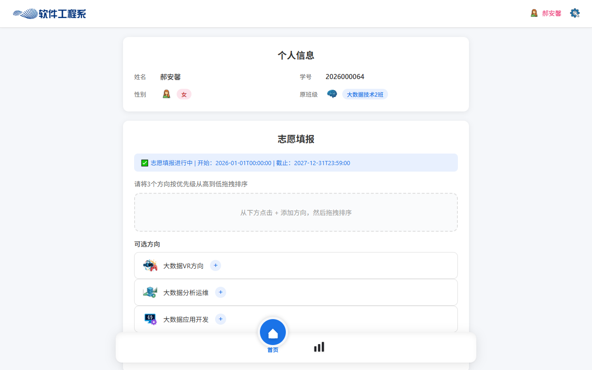
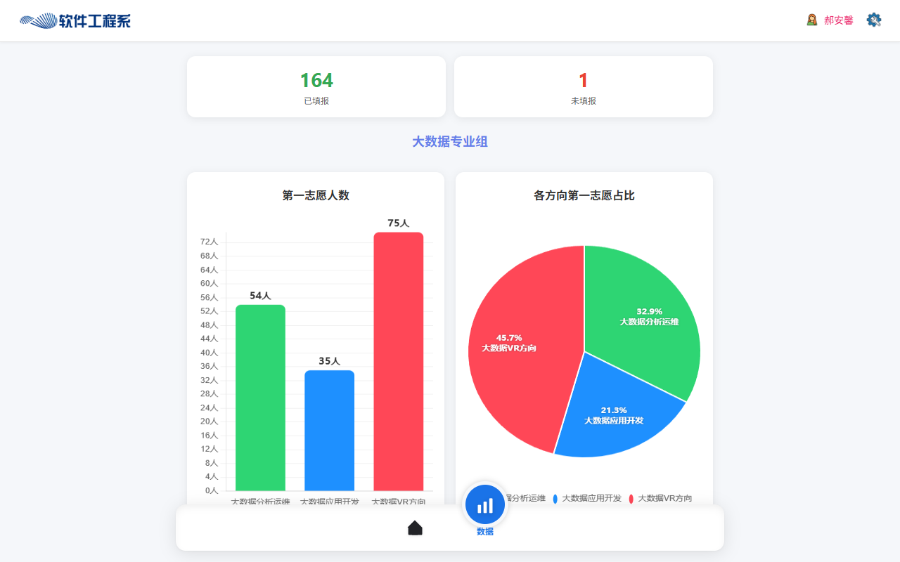
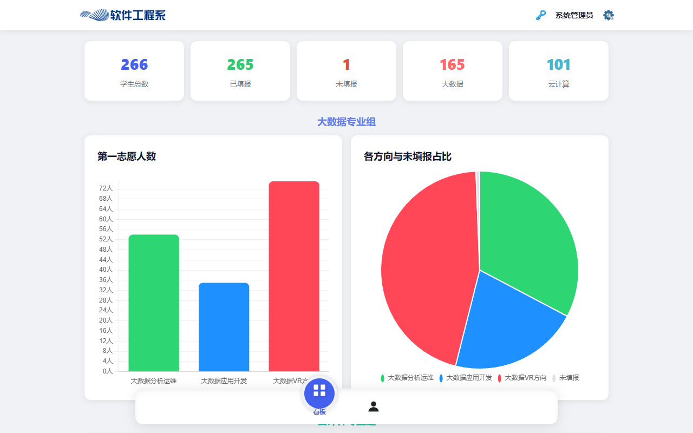
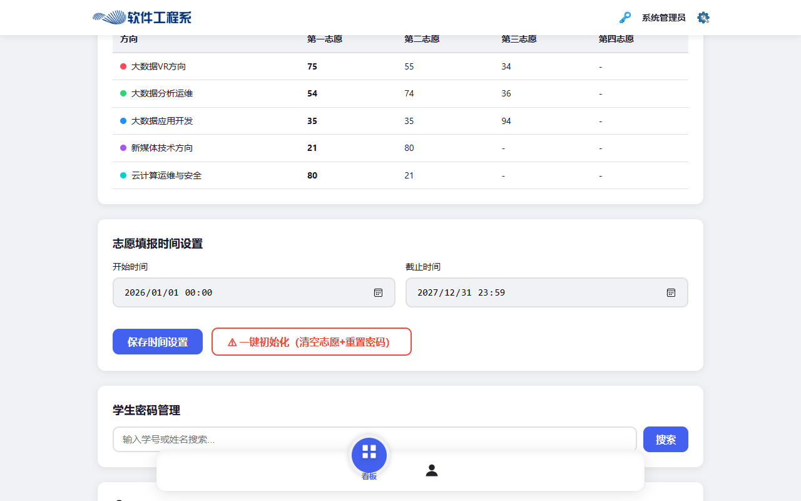
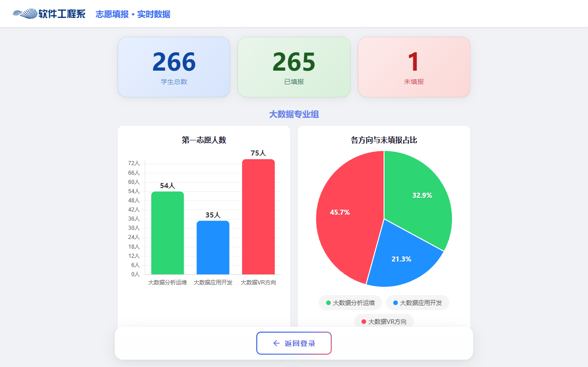

# 分班志愿填报系统 使用说明

> 适用版本：V1.0
> 文档面向对象：学生、管理员、系统运维人员
> 配套文档：[部署指南](DEPLOY.md) · [数据库结构说明](数据库结构.md)

---

## 目录

1. [系统简介](#一系统简介)
2. [快速上手（5 分钟）](#二快速上手5-分钟)
3. [学生端操作指南](#三学生端操作指南)
4. [管理员端操作指南](#四管理员端操作指南)
5. [实时数据大屏](#五实时数据大屏)
6. [常见问题（FAQ）](#六常见问题faq)
7. [演示数据说明](#七演示数据说明)

---

## 一、系统简介

本系统用于高校专业分流场景下的志愿填报与统计分析，包含三类使用角色：

| 角色 | 入口页面 | 能做什么 |
|------|----------|----------|
| **学生** | `student.html` | 登录、填写并提交志愿（拖拽排序）、查看本专业填报数据、修改密码 |
| **管理员** | `admin.html` | 查看统计与图表、管理学生账号、批量导入花名册、导出志愿结果、设置填报时间 |
| **访客** | `public-data.html` | 免登录查看实时填报进度大屏 |

系统覆盖 **5 个分流方向**：

- **大数据专业**：大数据VR方向、大数据分析运维、大数据应用开发
- **云计算专业**：云计算运维与安全、新媒体技术方向

> ⚠️ 业务规则：学生只能在本专业对应的方向内排序，**禁止跨专业选择**。

---

## 二、快速上手（5 分钟）

### 2.1 启动系统

```bash
npm install    # 首次运行，安装依赖
npm start      # 启动服务（默认端口 3000）
```

Windows 用户也可以直接双击根目录的 **`start.bat`**。

看到控制台输出 `Server running on port 3000` 即启动成功。详细部署说明见 [DEPLOY.md](DEPLOY.md)。

### 2.2 访问入口

| 页面 | 地址 |
|------|------|
| 登录页 | `http://localhost:3000/login.html` |
| 实时数据大屏 | `http://localhost:3000/public-data.html` |

局域网内其他设备访问时，把 `localhost` 换成服务器的内网 IP，如 `http://192.168.1.100:3000/login.html`。

### 2.3 演示账号

仓库自带 266 条**虚构**演示数据，开箱即可体验：

| 角色 | 账号 | 密码 | 说明 |
|------|------|------|------|
| 学生 | `2026000001` ~ `2026000266` | `123456` | 学号为 `2026` + 6 位序号 |
| 学生（未填报） | `2026000064` | `123456` | 用于体验首次填报流程 |
| 管理员（超级） | `admin` | `admin123` | 拥有全部管理权限 |
| 管理员（普通） | `teacher01` | `teacher123` | 普通管理权限 |

---

## 三、学生端操作指南

### 3.1 登录

1. 浏览器打开 `http://<服务器地址>:3000/login.html`
2. 确认选中 **「学生端」** 标签（默认）
3. 输入 **学号** 和 **密码**
4. 可勾选 **「记住我」** 保存登录状态
5. 点击 **「登 录」**


> 说明：
> - 点击密码框右侧的 **小眼睛图标** 可显示/隐藏密码
> - 点击 **「实时数据」** 可免登录查看填报进度大屏
> - 连续输错密码 **5 次**账号会被锁定，需联系管理员解锁
> - 若账号被标记为首次登录，系统会弹出**强制修改密码**窗口，设置新密码后才能进入

### 3.2 首页布局

登录成功后进入学生端首页，从上到下依次为：

- **顶栏**：系统名称 + 右上角个人入口（点击姓名或齿轮可**修改密码**、退出登录）
- **个人信息卡**：姓名、学号、性别、原班级
- **填报状态条**：绿色提示当前是否在填报时间内（显示开始与截止时间）
- **志愿排序区**：拖拽排序的操作区
- **可选方向列表**：本专业对应的全部方向卡片



### 3.3 填报志愿（5 步）

1. **添加方向**：在「可选方向」列表中，点击方向卡片右侧的 **`+`** 按钮，把方向加入上方排序区
2. **重复添加**：把本专业全部方向依次加入排序区
3. **拖拽排序**：按住排序区中的方向卡片上下拖动，按优先级**从高到低**排列（最上面 = 第一志愿）
4. **提交**：点击底部 **「提交志愿」** 蓝色按钮
5. **确认**：在弹出的确认框中核对志愿顺序，确认无误后提交

> ⚠️ 注意事项：
> - 所有方向都必须加入排序区才能提交（漏选会提示）
> - 截止时间内可以**反复修改并重新提交**，以最后一次提交为准
> - 超过截止时间后提交按钮不可用

### 3.4 查看填报数据

点击底部导航栏的 **「数据」** 图标，进入数据页面：

- **统计卡片**：本专业「已填报」和「未填报」人数
- **柱状图**：本专业各方向的第一志愿人数
- **饼图**：本专业各方向第一志愿占比



> 说明：学生只能看到**本专业**的数据（大数据学生看不到云计算的数据，反之亦然），这是系统的数据隔离设计。

### 3.5 修改密码

1. 点击右上角 **齿轮图标**
2. 选择 **「修改密码」**
3. 输入新密码（至少 6 位）并再次确认
4. 提交后下次登录使用新密码

### 3.6 退出登录

点击右上角个人入口，选择退出；或直接关闭浏览器。公共电脑上使用完请务必退出登录。

---

## 四、管理员端操作指南

### 4.1 登录

1. 打开登录页，切换到 **「管理端」** 标签
2. 输入管理员账号和密码（演示账号 `admin` / `admin123`）
3. 点击登录，进入管理员端

### 4.2 看板页：统计与图表

登录后默认进入 **「看板」** 页面：

**① 顶部统计卡片**（5 张）

| 卡片 | 含义 |
|------|------|
| 学生总数 | 系统中的学生账号总数 |
| 已填报 | 已提交志愿的学生数 |
| 未填报 | 尚未提交的学生数 |
| 大数据 | 大数据专业学生数 |
| 云计算 | 云计算专业学生数 |

> 💡 点击统计卡片可展开对应的**明细列表**（如点击「未填报」可查看具体未填报学生名单）。

**② 分组图表**

- 大数据专业组 / 云计算专业组各一组：柱状图（第一志愿人数）+ 饼图（各方向与未填报占比）
- 鼠标悬停在图表元素上可查看具体数值



### 4.3 各方向各志愿详细统计

看板页继续下拉，可看到 **「各方向各志愿详细统计」** 表格：

- 按方向逐行展示 **第一志愿 ~ 第四志愿** 各自的人数
- 用于分析志愿分布的冷热程度，辅助录取排序决策



### 4.4 志愿填报时间设置

1. 在管理页面找到 **「志愿填报时间设置」**
2. 分别点选 **开始时间** 和 **截止时间**
3. 点击 **「保存时间设置」**

> ⚠️ **「一键初始化（清空志愿+重置密码）」** 为红色危险按钮：会把所有学生的志愿记录清空、密码全部重置为初始值，仅用于新一轮填报开始前。**操作前请先备份数据库**（复制 `data/class_assignment.db`）。

### 4.5 学生密码管理

1. 在 **「学生密码管理」** 搜索框输入学号或姓名
2. 点击搜索结果行的 **「重置密码」**
3. 该学生密码恢复为初始值，下次登录后自行修改

### 4.6 账户锁定管理

- 学生连续输错密码 5 次会被自动锁定
- 在 **「账户锁定管理」** 中找到被锁学生，点击 **「解锁」** 即可恢复正常登录

### 4.7 数据导出

在 **「数据导出」** 区块：

| 按钮 | 导出内容 |
|------|----------|
| 按方向导出 | 以方向为维度汇总的志愿结果 Excel |
| 按专业导出 | 以专业为维度汇总的志愿结果 Excel |

点击后浏览器自动下载 `.xlsx` 文件，可直接用于录取工作。

### 4.8 账号管理

- 查看学生账号与管理员账号列表及状态（active / disabled）
- 对不再使用的账号执行 **「注销」**（单条）或 **「批量注销」**
- 超级管理员（super）才能注销管理员账号；super 账号本身不可被注销

### 4.9 批量导入

用于开学建号或补充新管理员，支持两种方式：

**① Excel 导入**

1. 点击 **「下载模板」**（学生模板 / 管理员模板）
2. 按模板格式填写 Excel（学生模板需含：学号、姓名、性别、专业、班级等列）
3. 点击 **「上传并导入」** 选择文件
4. 系统校验格式后批量建号，重复学号自动跳过

**② 手动录入**

1. 点击 **「手动录入导入」**
2. 切换 **「录入学生」/「录入管理员」** 标签
3. 逐条填写信息，可一次添加多条
4. 点击 **「提交导入」**

---

## 五、实时数据大屏

地址：`http://<服务器地址>:3000/public-data.html`，**无需登录**，适合投放在教室大屏或公告屏上。

页面内容：

- **顶部统计卡**：学生总数 / 已填报 / 未填报
- **大数据专业组**：柱状图 + 饼图
- **云计算专业组**：柱状图 + 饼图
- 数据**定时自动刷新**，无需手动操作



---

## 六、常见问题（FAQ）

### 登录类

| 问题 | 解决办法 |
|------|----------|
| 提示「学号或密码错误」 | 核对学号是否完整；确认在正确的标签页（学生端/管理端）登录 |
| 提示「账号已锁定」 | 连续输错 5 次触发锁定，联系管理员在「账户锁定管理」中解锁 |
| 提示「账号已停用」 | 账号被管理员注销，联系管理员处理 |
| 忘记密码 | 学生联系管理员在「学生密码管理」重置；管理员联系超级管理员 |

### 填报类

| 问题 | 解决办法 |
|------|----------|
| 「提交志愿」按钮点不动 | 检查是否所有方向都已加入排序区；确认当前在填报时间内 |
| 提交后想改 | 截止时间内重新排序再提交即可，以最后一次为准 |
| 看不到某个方向 | 方向按专业隔离，只能选本专业的方向 |
| 数据页显示 0 | 确认当前账号的专业字段正常；刷新页面重试 |

### 部署/访问类

| 问题 | 解决办法 |
|------|----------|
| 局域网设备打不开页面 | 确认服务已启动、防火墙已放行 3000 端口、访问的是服务器 IP |
| 图表不显示 | 确认 `frontend/assets/chart.umd.min.js` 文件存在 |
| Excel 导入失败 | 先用「下载模板」获取标准格式，严格按模板列填写 |

---

## 七、演示数据说明

本仓库 `data/class_assignment.db` 中的数据**全部为随机生成的虚构数据**：

- 266 名学生的姓名、学号均为程序生成，**不包含任何真实个人信息**
- 265 条志愿记录为模拟数据，用于演示统计图表效果
- 管理员仅保留 2 个演示账号

**用于正式环境前，请务必：**

1. 删除演示数据库：`rm data/class_assignment.db`
2. 重新初始化：`cd backend && python init_db.py`
3. 导入真实花名册：`python init_db.py <花名册.xlsx>`
4. 修改所有默认密码

---

> 如在使用中遇到本文档未覆盖的问题，欢迎到项目仓库提交 Issue。
